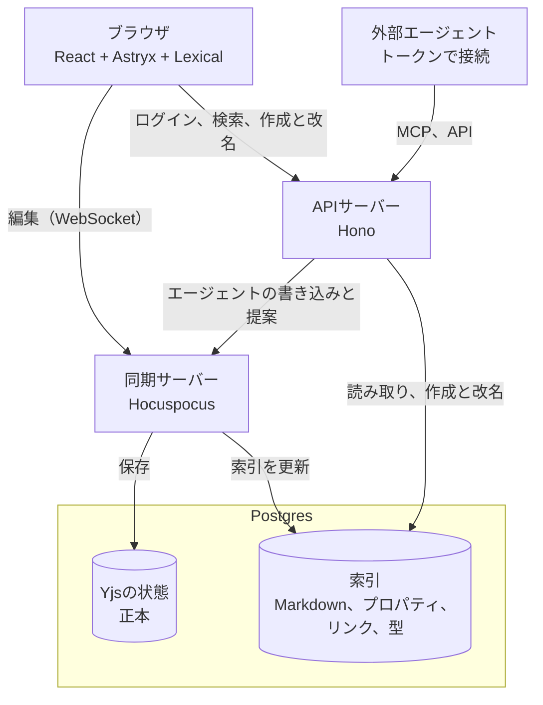

# アーキテクチャ

部品は3つとPostgres 1つで、言語はすべてTypeScriptです。書き込みはすべて同期サーバーを通ってYjsドキュメントに入り、読み取りはPostgresの索引を見ます。

## 部品

| 部品         | 場所          | 役割                                                                                |
| ------------ | ------------- | ----------------------------------------------------------------------------------- |
| Web          | `apps/web`    | エディタ、インフォボックス、一覧、検索、設定                                        |
| APIサーバー  | `apps/api`    | ログイン、メンバー管理と `can()`、ページの作成と改名、検索、MCP、取り込みと書き出し |
| 同期サーバー | `apps/sync`   | 接続時の権限確認、Yjsの保存、索引の更新、編集者の記録                               |
| Postgres     | `packages/db` | ユーザー、ワークスペース、ページ、Yjsの状態、索引、提案、記録                       |

共有するコードは `packages/` に置きます。

| パッケージ         | 中身                                                      | 使う側         |
| ------------------ | --------------------------------------------------------- | -------------- |
| `@brainoid/core`   | 予約語、クラスとプロパティの解決など、純粋なロジック      | すべて         |
| `@brainoid/editor` | Lexicalのノード、Markdownとの変換規則、headlessのエディタ | web、api、sync |
| `@brainoid/db`     | スキーマと接続                                            | api、sync      |

依存の向きは `apps → packages`、`editor → core` です。`core` は何にも依存しません。

## データの流れ

### 人が書く

1. ブラウザのLexicalが、`@lexical/yjs` を通してYjsドキュメントを更新する。
2. 更新はWebSocketで同期サーバーに届き、同じページを開いているほかの人に配られる。
3. 同期サーバーは、少し間を置いてからYjsの状態をPostgresに保存する。
4. 保存のたびに、headlessのLexicalで本文をMarkdownに直し、プロパティ、リンク、型を取り出して索引を書き直す。

### エージェントが書く

1. エージェントがMCPのツールを呼ぶ。
2. APIサーバーがトークンの権限を確かめる。
3. APIサーバーが同期サーバーのサーバー側接続を使って、同じYjsドキュメントを更新する。本文への追記は、headlessのLexicalをその文書につないで行う。
4. 以降は人が書いたときと同じ。開いている人の画面にすぐ反映される。

### 読む

クラスのインスタンス一覧、バックリンク、検索、MCPの読み取りは、すべて索引を見ます。Yjsドキュメントを読みに行くのは、エディタと保存の処理だけです。

## 決めてあること

- **正本はページごとのYjsドキュメント。** 本文とプロパティが入る。Markdownは書き出しの形式。（[ADR-0005](../adr/0005-yjs-is-source-of-truth.md)）
- **タイトルはYjsに入れない。** 「ワークスペース内で一意」は自動マージでは保証できないので、APIを通してDBの一意制約で守る。
- **本文のYjsを直接書かない。** コードによる編集もLexicalを通す。`@lexical/yjs` の内部の形に依存しないため。
- **ノードと変換規則はブラウザとサーバーで共有する。** 往復テストを1つにするため、`@brainoid/editor` に置く。
- **権限の確認は `can()` に集約する。** ワークスペース単位だが、将来ページ単位にするときに裏を差し替えられるようにする。（[ADR-0006](../adr/0006-workspace-level-permissions.md)）

## 入れないもの

| 入れないもの           | 理由                                                       |
| ---------------------- | ---------------------------------------------------------- |
| グラフDB               | クラスの階層とバックリンクは、Postgresの再帰クエリで足りる |
| ベクトルDB、Redis      | 必要になってから足す。同期サーバーは最初は1台で動かす      |
| 権限エンジン           | ワークスペース単位なら、メンバーの表1つで足りる            |
| ホスト型の同期サービス | 研究データを自分たちのDBに置くことを優先する               |

## ポート（開発時）

| 部品         | ポート | 環境変数       |
| ------------ | ------ | -------------- |
| Web          | 5173   | なし           |
| APIサーバー  | 8787   | `API_PORT`     |
| 同期サーバー | 8788   | `SYNC_PORT`    |
| Postgres     | 5432   | `DATABASE_URL` |

Webからは `/api` でAPIサーバーに届きます（Viteのプロキシ）。
