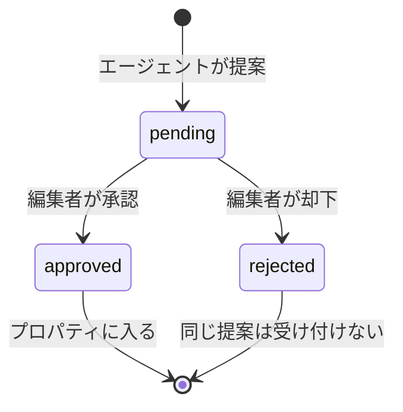

# 型付けと提案

方針は「まずルール、次にAI、どちらも書く人の邪魔をしない」です。人が承認したものだけが事実になります。

## ルールで付ける（AIなし）

| ルール         | 内容                                                                                                                    | チケット |
| -------------- | ----------------------------------------------------------------------------------------------------------------------- | -------- |
| リンク先の型   | プロパティの `range` に従い、その値として新しく作られたページに型を付ける。`著者` の値なら人物、`使用手法` の値なら手法 | T-044    |
| 書誌情報       | DOIやarXivのURLから、著者、発表年、掲載先を入れる                                                                       | T-070    |
| 未リンクの言及 | 本文に既存ページのタイトルや別名が出てきたら、リンクの候補として示す                                                    | T-071    |

## 提案

提案を書くのは、外部のエージェント（MCP）です。アプリ内のAIは作りません。あとで足す場合も、同じ置き場に同じ形で書きます。

- **対象**：型のないページへのクラスの提案と、本文に根拠があるプロパティ値の提案。本文にない事実は提案しない。
- **見え方**：インフォボックスに琥珀色の行として出す。提案者の名前と、承認、却下のボタンが付く。
- **根拠**：提案には、根拠にした本文の箇所を付けられる。行にカーソルを合わせるか「根拠を表示」を押すと、その箇所が光る。
- **却下の記憶**：却下された提案は二度と出さない。同じページ、同じキー、同じ値の提案は受け付けない。

## 提案の一生



| 状態     | 画面             | Markdown     | エージェントへの返し方       |
| -------- | ---------------- | ------------ | ---------------------------- |
| pending  | 琥珀色の行       | 書き出さない | 「未確認」として別の欄で返す |
| approved | 通常のプロパティ | 書き出す     | 通常のプロパティ             |
| rejected | 出さない         | 書き出さない | 返さない                     |

## データの持ち方（案）

- 未承認の提案は、ページのYjsドキュメントの `proposals` マップに置く。開いている人の画面にすぐ出る。
- 承認と却下はAPIを通す（`POST /proposals/:id/approve`）。APIサーバーが、同じトランザクションで `props` に書き、`proposals` から消す。
- 提案者、承認者、時刻はPostgresの `proposals` 表に記録する。Yjsは誰が書いたかを人の単位で持たないため。

提案1件の形は次のとおりです。

```ts
type Proposal = {
  id: string;
  key: string; // 'type' またはプロパティ名
  value: PropertyValue; // data-model.md を参照
  proposedBy: { kind: 'agent'; tokenId: string; name: string };
  evidence?: { quote: string }; // 根拠にした本文の一節
  createdAt: string;
};
```

根拠の持ち方（本文の一節を文字列で持つか、位置で持つか）は、T-042で決めます。本文が編集されても壊れにくいのは文字列です。

## 抜けの見える化

一覧が完全でないときに、それが分かるようにします（T-045）。

- クラスページに「未確認の候補 N件」を出す。その型を提案されているが、まだ承認されていないページ。
- クラスページとクラス一覧に「型のないページ N件」を出す。
- ページ一覧のカードに「提案 N件」を出す。
