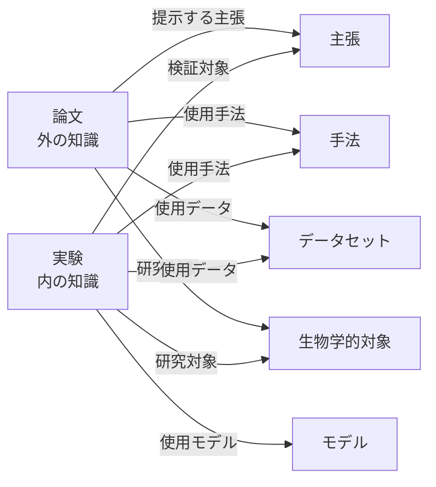

# 研究用テンプレート

クラスは8つです。論文（外の知識）と実験（内の知識）が、主張、手法、データセット、モデル、生物学的対象を介してつながります。

テンプレートは、クラスとプロパティのページの集まりです。ワークスペースを作るときに投入します（T-046）。投入したあとは普通のページなので、チームが自由に直せます。

## クラス

| クラス       | 提案するプロパティ                                                                               | 外部語彙（`same_as`）                 |
| ------------ | ------------------------------------------------------------------------------------------------ | ------------------------------------- |
| 論文         | 著者、発表年、掲載先、URL、使用手法、使用データ、研究対象、提示する主張                          | `https://schema.org/ScholarlyArticle` |
| 実験         | 実施日、担当、プロジェクト、使用手法、使用データ、使用モデル、研究対象、検証対象、結果、比較対象 | なし                                  |
| 主張         | なし（バックリンクで足りる）                                                                     | `https://schema.org/Claim`            |
| モデル       | 使用手法、使用データ、研究対象、派生元、URL                                                      | 未決                                  |
| 手法         | 派生元                                                                                           | なし                                  |
| データセット | 研究対象、URL                                                                                    | `https://schema.org/Dataset`          |
| 生物学的対象 | なし（別名と外部IDを使う）                                                                       | なし                                  |
| 人物         | 所属                                                                                             | `https://schema.org/Person`           |

このほかに、プロパティの定義を置く「プロパティ」クラスがあります。

## プロパティ

| プロパティ   | `value_type` | `range`      | 複数   | 備考                                                   |
| ------------ | ------------ | ------------ | ------ | ------------------------------------------------------ |
| 著者         | link         | 人物         | できる | `same_as: https://schema.org/author`                   |
| 発表年       | number       |              |        | `same_as: https://schema.org/datePublished`            |
| 掲載先       | link         |              |        | 型なしのページでよい。`https://schema.org/isPartOf`    |
| URL          | string       |              |        | 論文はDOIを書く。`https://schema.org/url`              |
| 所属         | link         |              |        | 型なしのページでよい。`https://schema.org/affiliation` |
| 提示する主張 | link         | 主張         | できる |                                                        |
| 検証対象     | link         | 主張         |        |                                                        |
| 結果         | string       |              |        | `choices: [支持, 反証, 不明]`                          |
| 使用手法     | link         | 手法         | できる |                                                        |
| 使用データ   | link         | データセット | できる |                                                        |
| 使用モデル   | link         | モデル       |        |                                                        |
| 研究対象     | link         | 生物学的対象 | できる |                                                        |
| 比較対象     | link         |              | できる | 論文または実験                                         |
| 派生元       | link         |              |        | 手法またはモデル                                       |
| 実施日       | date         |              |        |                                                        |
| 担当         | link         | 人物         | できる |                                                        |
| プロジェクト | link         |              |        | 型なしのページでよい                                   |

## 答えられる質問

- 「この論文の主張に反する実験はうちにあるか」
- 「手法Xを使った論文と自分たちの実験を並べて」
- 「まだ誰も検証していない主張はどれか」
- 「p53に関する論文、モデル、実験を全部」

## 運用ルール

1. **クラスは名詞、プロパティは関係の名前にする。** タイトルは一意なので、クラスの `手法` とプロパティの `手法` は共存できない。`使用手法` や `検証対象` のように名付ける。
2. **クラスは増やさない。** 日常で増えるのはインスタンスだけ。ResNetは `手法` のインスタンスで、系統は `派生元` で表す。
3. **考えやメモは型なしのままでいい。** 仮説も、論文が述べていることも、主張のページにして両側から指す。
4. **粗く始めて、後で分ける。** 生物学的対象は遺伝子やタンパク質に、実験はウェット、シミュレーション、学習に、必要になってから下位クラスへ分ける。上位クラスの一覧は壊れない。
5. **手法とモデルを分ける。** 手法は一般的な技法、モデルは特定の対象のために作った1つ。数理モデルも機械学習モデルも同じクラスに入れる。

## Kaggleの扱い

追加のクラスなしで同じ骨格に載せます。

- コンペは型なしのページにして、`プロジェクト` から指す。
- スコアはテンプレートに入れず、`CVスコア` のように自由に足す。
- 「target encodingはこのデータで効く」のような知見も主張のページにして、実験で支持か反証かを付ける。

## 下位クラスに分けるとき

生物学的対象を分けるときは、Bioschemas由来でschema.orgに取り込まれた型に対応させます。

| 下位クラス | 外部語彙                     |
| ---------- | ---------------------------- |
| 遺伝子     | `https://schema.org/Gene`    |
| タンパク質 | `https://schema.org/Protein` |
| 生物種     | `https://schema.org/Taxon`   |
