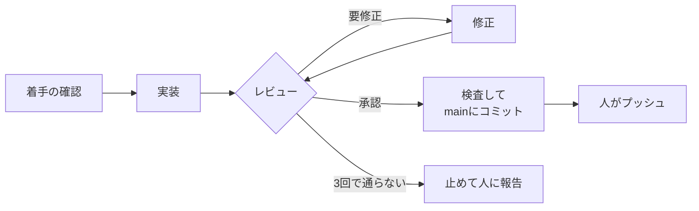

# チケットからコミットまで

実装はチケット単位で進めます。1チケットが1コミットです。ブランチとPRは使わず、`main` に直接コミットします。レビューは、コミットの前に、実装とは別のサブエージェントが行います。プッシュは人が行います。

## 流れ

Claude Codeで `/implement-ticket T-012` を実行すると、1から6までが進みます。



1. **選ぶ。** `pnpm tickets:next` で、依存が片付いているチケットを見る。
2. **着手を確かめる。** チケットの状態、依存、未決事項を見る。`main` にいて、作業ツリーに変更がないことを確かめ、`origin/main` を取り込む。
3. **実装する。** 実装のサブエージェントが、チケットの「やること」をテストと一緒に書く。「やらないこと」には手を出さない。
4. **レビューする。** レビューのサブエージェントが、差分を読み、`pnpm check` を実行し、受け入れ条件を1つずつ確かめて、「承認」か「要修正」かを判定する。
5. **直す。** 「要修正」なら、実装のサブエージェントが指摘を直し、4に戻る。レビューは3回まで。通らなければ、コミットせずに止めて人に報告する。
6. **コミットする。** 「承認」になったら、進行役が `pnpm check` を通し、チケットの `status` を `done` にして、`main` に1コミットで入れる。
7. **プッシュする。** 人が行う。skillはプッシュしない。

## 役割

| 役割     | だれが                                   | すること                                                                     |
| -------- | ---------------------------------------- | ---------------------------------------------------------------------------- |
| 進行役   | `/implement-ticket` を実行したClaude Code | 着手の確認、サブエージェントへの依頼、繰り返しの管理、最後の検査、コミット   |
| 実装     | `ticket-implementer` サブエージェント    | コードとテストを書く。レビューの指摘を直す。コミットはしない                 |
| レビュー | `ticket-reviewer` サブエージェント       | 差分を読み、検査を実行し、受け入れ条件を確かめて判定する。ファイルは変えない |

実装とレビューを分けているのは、書いた側の思い込みを、レビューに持ち込まないためです。レビューのサブエージェントは、実装した側の説明を受け取らず、チケット、設計書、差分だけから判断します。

サブエージェントの定義は `.claude/agents/`、skillは `.claude/skills/implement-ticket/` にあります。レビューの観点を変えたいときは、`.claude/agents/ticket-reviewer.md` を直します。

## まとめて進める

`/implement-tickets` は、`/implement-ticket` を1件ずつ繰り返し呼び出して、複数のチケットを順番に進めます。1件ごとの手順は変わりません。チケットごとに実装とレビューを通し、1チケットを1コミットにします。

```text
/implement-tickets                  todo が残っている、いちばん手前のマイルストーン
/implement-tickets M0               そのマイルストーン
/implement-tickets T-001 T-002      挙げたチケット
/implement-tickets M2 3件           範囲のうち、先頭から3件
/implement-tickets 全部             todo のすべて
```

| 場面                             | 動き                                                                                       |
| -------------------------------- | ------------------------------------------------------------------------------------------ |
| 始める前                         | `main` にいて変更がないこと、`pnpm check` が通ることを確かめる。リモートの取り込みはここで1回だけ |
| 最初                             | 進める順番、チケットの「未決事項」、設計書の「案」に当たったときの扱いを、まとめて1回で聞く |
| 進行中                           | 聞かずに進める。決まっていないことに当たったチケットと、それに依存するチケットは飛ばす     |
| コミットせずに止まったチケットが出た | 全体を止める。変更は作業ツリーに残る。次のチケットには進まない                             |
| 最後                             | 結果の一覧、人が決めること、範囲の外で見つかったことを報告する。プッシュはしない           |

長く回すほど、人が見ていないコミットが `main` に溜まります。マイルストーンごとに区切り、区切りごとに中身を見てプッシュすることを勧めます。M3以降のチケットは、M1とM2で分かったことに合わせて直す前提で書いてあるので、`全部` で一気に進めるのには向きません。

## 決まり

| 項目     | 決まり                                                                                   |
| -------- | ---------------------------------------------------------------------------------------- |
| ブランチ | 切らない。`main` の上で作業する                                                          |
| コミット | 1チケットを1コミットにする。レビューが「承認」になるまでコミットしない                   |
| 1行目    | `T-012: チケットの題`                                                                    |
| 本文     | 何を作ったかを2〜3行。受け入れ条件を確かめた件数と、レビューの回数を添える。日本語で書く |
| プッシュ | 人が行う。Claude Codeはプッシュしない                                                    |
| 大きさ   | 1回のレビューで読み切れる量を目安にする。超えそうなら、チケットを分ける                  |

## プッシュの前に

コミットは手元の `main` にあります。プッシュの前に、入るものを見ます。

```bash
git log origin/main..main --stat   # これからプッシュするコミット
git show HEAD                      # 直前のコミットの中身
git push
```

気になる点があれば、プッシュの前に直します。Claude Codeに頼むなら、何を直すかを伝えて、もう一度レビューを通させます。

## チケットの状態

状態はチケットのファイルの先頭（frontmatter）に書きます。

| 状態          | 意味   | どこで見えるか                           |
| ------------- | ------ | ---------------------------------------- |
| `todo`        | 未着手 | `main`                                   |
| `in-progress` | 着手中 | 作業している人の手元だけ。コミットしない |
| `done`        | 完了   | コミット後の `main`                      |

`main` の履歴の上では、チケットは `todo` か `done` のどちらかです。着手中かどうかは、リポジトリからは分かりません。

## 複数人で進めるとき

- **着手を知らせる。** 同じチケットに2人が着手しないよう、着手するときはチームに知らせる。
- **こまめにプッシュする。** 手元にコミットを溜めると、ほかの人の `main` と分かれやすい。
- **プッシュが断られたら、取り込んでからやり直す。** `git pull --rebase` のあとに `pnpm check` を通し、プッシュする。チケットごとにファイルが分かれているので、状態の更新で衝突することはない。
- **1つの作業ツリーでは、1度に1チケット。** 同じマシンで並行して進めるなら、クローンを分ける。
- **CIは `main` へのプッシュで回る。** 落ちたら、ほかの作業より先に直す。

## 途中で分かったこと

| 分かったこと                 | すること                                                                       |
| ---------------------------- | ------------------------------------------------------------------------------ |
| チケットの範囲では足りない   | 足りない分を新しいチケットにする（`/create-ticket`）。いまのコミットに入れない |
| チケットが大きすぎる         | 止めて、分けてから進める                                                       |
| 設計書と違う作りにしたい     | 止めて相談する。決まったら、設計書とADRを同じコミットで直す                    |
| 設計書に「案」「未決」とある | 実装の前に、人に確認する。決めた内容を設計書に書き戻す                         |
| 受け入れ条件を満たせない     | `done` にしない。コミットせずに、満たせない理由を報告して相談する              |
| レビューが3回で通らない      | コミットせずに止まる。変更は作業ツリーに残るので、指摘を見て、進め方を決める   |

## 手で書いたとき

skillを使わずに人が書いた変更も、コミットの前にレビューを通します。Claude Codeで、次のように頼みます。

```text
ticket-reviewer サブエージェントで、T-012 の変更をレビューして
```

## Claude Codeの設定

- skillは `.claude/skills/`、サブエージェントは `.claude/agents/`、パスごとのルールは `.claude/rules/` にある。
- チーム共通の許可は `.claude/settings.json`、個人の設定は `.claude/settings.local.json`（コミットしない）。
