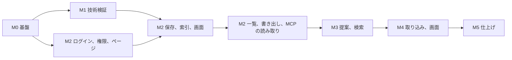

# 実装チケット

v1を、1コミットで入る大きさのチケットに分けてあります。1チケットが1ファイルで、状態はファイルの先頭に書きます。

```bash
pnpm tickets                  # 一覧
pnpm tickets --milestone M2   # マイルストーンで絞る
pnpm tickets:next             # 依存が片付いていて、着手できるもの
pnpm tickets:check            # 書式と依存の確認（CIでも回る）
```

進め方は [docs/dev/workflow.md](../dev/workflow.md)、Claude Codeでは `/implement-ticket T-001`、まとめて進めるなら `/implement-tickets M0` です。

## マイルストーン

| 番号 | 名前         | 終わったときにできること                                                     | チケット     |
| ---- | ------------ | ---------------------------------------------------------------------------- | ------------ |
| M0   | 基盤         | DB、設定、API、画面の枠がそろい、機能を足していける                          | T-001〜T-004 |
| M1   | 技術検証     | 共同編集、プロパティの同期、Markdownの往復が動くと確かめてある               | T-010〜T-015 |
| M2   | 薄く一通り   | ログインして、ページを書き、リンクと型を付け、書き出し、エージェントが読める | T-020〜T-038 |
| M3   | 型付けと提案 | エージェントが提案し、人が承認する。全文検索ができる                         | T-040〜T-050 |
| M4   | チームで使う | いまのノートを取り込み、一覧、検索、設定の画面で日常の記録ができる           | T-060〜T-067 |
| M5   | 仕上げ       | 論文の取り込み、記録、E2Eテスト、デプロイ                                    | T-070〜T-075 |

M1は、仕様の「最初の試作で確かめること」の3点にあたります。ここが通らないと構成が変わるので、M2より先に終わらせます。M1の最後のT-014で、分かったことを設計書と以降のチケットに書き戻します。

M1の最初に、エディタをAstryxのリッチテキスト部品の上に作るかどうかを決めます（T-015）。結論によって、T-010〜T-012の進め方が変わります。

## 最初に着手できるもの

依存のないチケットは5つあります。並行して進められます。

- T-001 DBの接続とマイグレーションの土台
- T-002 環境変数の読み込みと検証
- T-004 Webの共通基盤（Astryxの `AppShell` で画面の枠を作る）
- T-015 Astryxのリッチテキスト部品を土台にするかを決める
- T-031 クラスとプロパティの解決ロジック（DBも画面も要らない、純粋なロジック）

## 大まかな流れ



細かい依存は、各チケットの `depends_on` にあります。

## チケットの読み方

| 欄           | 中身                                                                |
| ------------ | ------------------------------------------------------------------- |
| `id`         | `T-` と3桁の数字。ファイル名の先頭と同じ                            |
| `status`     | `todo`、`in-progress`、`done`                                       |
| `milestone`  | `M0`〜`M5`                                                          |
| `size`       | `S`（半日ほど）、`M`（1〜2日）、`L`（3日ほど）。Lを超えるなら分ける |
| `depends_on` | 先に終わっている必要があるチケット                                  |
| `owner`      | 着手した人。着手するときに書く。完了後も残してよい                  |
| 目的         | 何のためのチケットか                                                |
| 参照         | 先に読む設計書                                                      |
| やること     | このチケットで作るもの                                              |
| やらないこと | このチケットで作らないもの。作りたくなったら、別のチケットにする    |
| 受け入れ条件 | これを全部満たしたら完了。レビューが1つずつ確かめる                 |
| 未決事項     | 着手の前に、人が決める必要があること                                |

## 足す、分ける、直す

- 新しい作業が出たら、[_template.md](_template.md) を写して足す。Claude Codeでは `/create-ticket`。
- 番号は、マイルストーンごとの帯の中で次の空きを使う（M2なら T-020〜T-039）。帯が埋まったら、T-100以降を使う。
- 大きすぎると分かったチケットは、着手の前に分ける。元のチケットは消さず、範囲を狭めて残す。
- M3以降のチケットは、M1とM2で分かったことに合わせて直す前提で書いてある。着手の前に、設計書と食い違っていないかを確かめる。
- 完了したチケットは消さない。何をどの範囲でやったかの記録になる。
